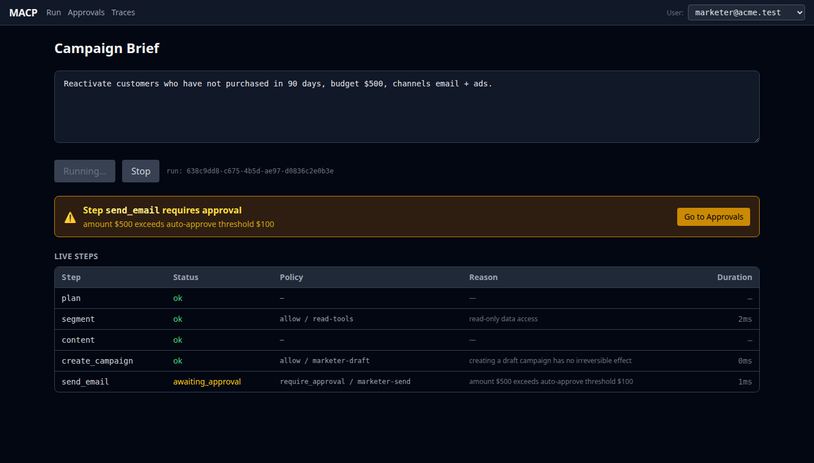
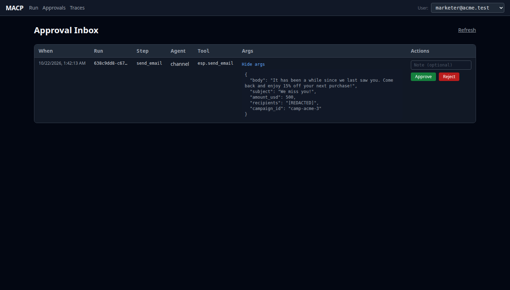
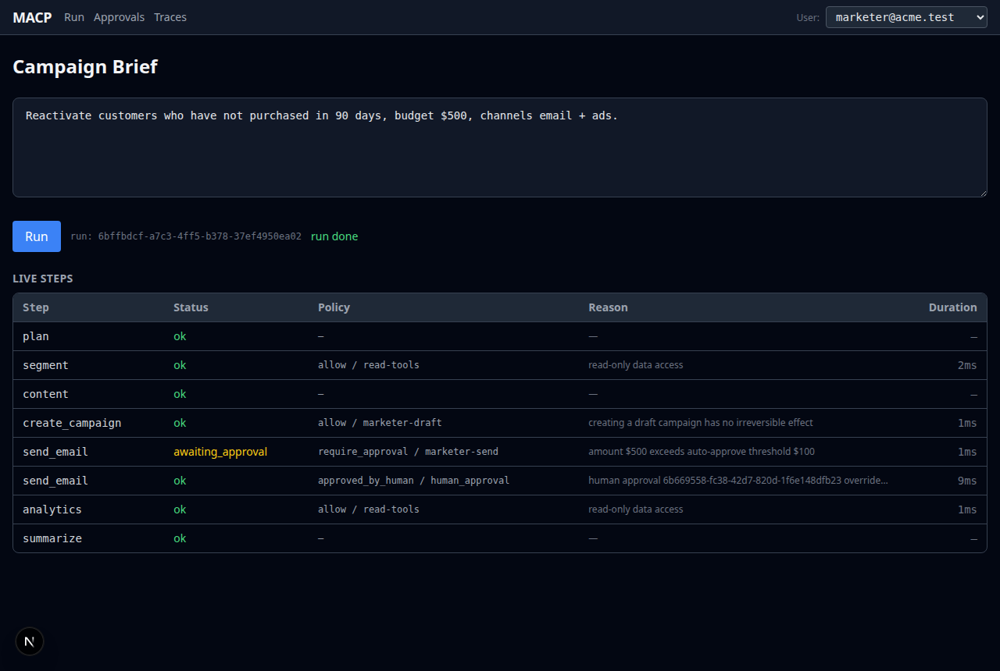
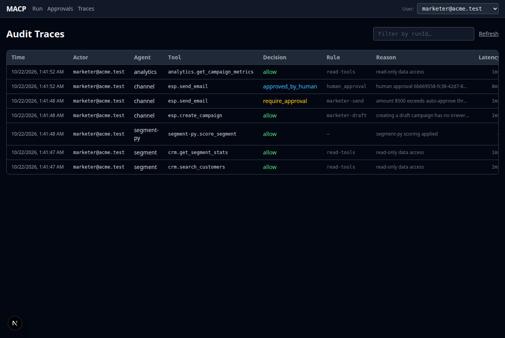

# MACP — Agent-First Marketing Ops Control Plane

A working prototype of the layer that has to exist before you let AI agents touch a
multi-tenant B2B product: **agents get identities, permissions, budgets, an audit trail, and a
supervised path to executing real side effects.**

The marketing scenario is deliberately thin. The control layer is the artefact.

> **What this is not:** a product. Integrations are fake on purpose. Policy, tenant isolation,
> audit and durability are not — see [What is real, what is mocked](#what-is-real-what-is-mocked).

---

## The one thing to look at

A marketer submits a brief. The planner decomposes it. When the workflow reaches
`esp.send_email` for $250, the policy decision point returns **`require_approval`** — acme's
policy auto-approves spend up to $100. The run suspends, its state in Postgres.

**Now kill the control plane and start it again.** The approval is still pending. Approve it,
and the workflow resumes *at that step* — the segment is not recomputed, the campaign is not
created twice, no email is re-sent.

Then submit the same brief as `marketer@globex.test`. Different policy, no pause, different
data. Same code.

---

## Architecture

```
┌──────────────────────────────────────────────────────────────┐
│  Web UI (Next.js)                                            │
│  1) Brief + live plan (SSE)   2) Approval Inbox   3) Traces  │
└───────────────┬──────────────────────────────────────────────┘
                │ HTTP/SSE   (identity → tenant_id + role)
┌───────────────▼──────────────────────────────────────────────┐
│  Control Plane (Node / TypeScript)                           │
│    Tenant context ─ every DB access inside withTenant()      │
│    Durable workflow engine ─ steps, snapshots, compensation  │
│    Agents: planner / content / channel / analytics           │
│  ┌────────────────────────────────────────────────────────┐  │
│  │  PDP  ── allow │ deny │ require_approval │ over($X)     │  │
│  │  every decision → audit_log, args redacted             │  │
│  └────────────────────────────────────────────────────────┘  │
└───────┬──────────────┬───────────────┬───────────────┬───────┘
        │ MCP          │ MCP           │ MCP           │ MCP
┌───────▼──────┐ ┌─────▼───────┐ ┌─────▼──────┐ ┌──────▼───────┐
│ fake-CRM     │ │ fake-ESP    │ │ analytics  │ │ segment-py   │
│ OAuth2.1+PKCE│ │ send/budget │ │ read-only  │ │ Python 3.12  │
│              │ │ + refund    │ │            │ │ (polyglot)   │
└──────────────┘ └─────────────┘ └────────────┘ └──────────────┘
        │
┌───────▼──────────────────────────────────────────────────────┐
│  Postgres 16 — Row Level Security on every tenant table      │
└──────────────────────────────────────────────────────────────┘
```

**The invariant that holds the whole thing up:** an agent has no network client, no API key
and no database handle. Its only effector is `guardedCall(...)`, which evaluates policy,
writes an audit record for *every* outcome, and only then — on `allow` — makes the MCP call.

---

## Quickstart

Requires Node 22+, pnpm 11+, Docker, and [uv](https://docs.astral.sh/uv/) for the Python agent.
No API keys needed: the agents run on deterministic canned output (`MACP_FAKE_LLM=1`) unless
you point them at a model.

```bash
docker compose up -d postgres                 # Postgres 16 on :5433
pnpm install && pnpm migrate && pnpm seed     # schema, RLS roles, two tenants
(cd services/segment-py && uv sync)           # the Python MCP server's venv
pnpm demo                                     # scripted end-to-end run, including the kill
```

`pnpm demo` starts four MCP servers and the control plane, submits a brief, waits for the
approval, **kills the control plane, restarts it**, approves, and checks that the run resumed
at the suspended step without replaying the four completed ones. Then it runs the same brief
for the second tenant and prints the audit trail.

### With a real model

Any OpenAI-compatible endpoint works (OpenAI, an LLM gateway, vLLM). Structured output is
validated with zod and fails closed.

```bash
export LLM_BASE_URL=https://api.openai.com/v1 LLM_API_KEY=sk-... LLM_MODEL=gpt-4o-mini
npx tsx scripts/llm-smoke.ts        # planner, content and summarizer, once each
MACP_DEMO_REAL_LLM=1 pnpm demo      # the full demo on that model
```

Verified on `deepseek-v4.1-flash` through an OpenAI-compatible gateway: the full demo passes.
The email copy comes from the model; the amount the policy checks does not (see below).

### The UI

```bash
pnpm dev:stack  # four MCP servers + control plane on :3001 (real agents if LLM_API_KEY is set)
pnpm dev:web    # UI on :3000
```

If the UI runs on another port, set `MACP_WEB_ORIGIN` for CORS.

---

## The 90-second demo (UI)

1. Open `http://localhost:3000` as **marketer@acme.test**. Submit:
   *"Reactivate customers who have not purchased in 90 days, budget $500, channels email + ads."*
2. Steps stream in. They go green until `send_email` turns **amber**:
   `require_approval / marketer-send — amount $500 exceeds auto-approve threshold $100`.
3. Kill the control plane process and start it again.
4. Open `/approvals`. The request is still there, with the recipients redacted. Approve it.
5. The run resumes **at `send_email`** and finishes. `/traces` shows every policy decision,
   including the pause and the human override, with latency per call.
6. Switch the header to **marketer@globex.test** and submit the same brief. No pause: their
   policy auto-approves this amount. Different segment data too, and none of acme's runs.

Steps 3–5 are the point of the exercise.

| Run paused on a policy decision | Approval inbox (recipients redacted) |
|---|---|
|  |  |
| **Run resumed and finished** | **Audit trace** |
|  |  |

---

## What is real, what is mocked

Being explicit about this is part of the artefact.

| Component | Status |
|---|---|
| **Policy decision point** | **Real.** Pure evaluator, declarative per-tenant rules in Postgres, 37-case decision matrix test. |
| **Multi-tenant isolation** | **Real.** Postgres RLS, `FORCE ROW LEVEL SECURITY`, non-superuser app role, fail-closed predicate, negative tests. |
| **Audit trail** | **Real.** Every decision persisted, including denials, with policy-declared redaction of recipient lists. |
| **Durability / HITL / saga** | **Real.** Snapshots and an idempotency ledger in Postgres; resume after process death is tested, not asserted. |
| **MCP protocol layer** | **Real.** Streamable HTTP, official SDK, OAuth 2.1 + PKCE with tenant-bound short-lived tokens, no token passthrough. |
| **Polyglot agent** | **Real.** Separate Python 3.12 process, reached only over MCP through the same policy gateway. |
| **Credential encryption** | **Real** mechanism (AES-256-GCM envelope), **demo** master key from the environment. |
| CRM / ESP / analytics data | **Mocked.** Deterministic generators seeded per tenant. No email is ever sent. |
| Authentication | **Mocked.** An `X-MACP-User` header stands in for a session. No IdP, no passwords. |
| Authorization server | **Demo-grade.** In-memory, no login UI, no client registration. Correct PKCE flow, not a production AS. |
| LLM calls | **Optional.** Real via an OpenAI-compatible gateway, or `MACP_FAKE_LLM=1` for deterministic offline runs. |
| Rate limiting, circuit breakers | **Absent.** The largest gap to production — see `docs/SCALE-LIMITS.md` §5. |
| Multi-region, data residency | **Absent.** Named as a known-unknown, not hand-waved. |

---

## Deliberately not built

Anything that does not move one of the three questions this repo answers — *can it isolate
tenants, can it govern agent actions, can it survive a restart mid-decision* — was cut:

more integrations, prettier copy, a real IdP, RAG or a vector store, Kubernetes, a design
system, an agent marketplace, evaluation harnesses for output quality.

---

## Documentation

The documentation is half the artefact; it is where the reasoning lives.

| Document | Question it answers |
|---|---|
| [ADR-001](docs/adr/ADR-001-agent-first-control-plane.md) | Why a control plane rather than a chatbot on the side |
| [ADR-002](docs/adr/ADR-002-orchestration.md) | Own step engine vs Mastra workflows, LangGraph.js, Temporal — and what it costs |
| [ADR-003](docs/adr/ADR-003-mcp-as-the-only-integration-boundary.md) | Why MCP is the only integration boundary and direct SDK calls are banned |
| [ADR-004](docs/adr/ADR-004-multi-tenant-isolation.md) | RLS, per-tenant credentials, tenant on every audit row |
| [ADR-005](docs/adr/ADR-005-permission-model-pdp.md) | The permission model, and why `require_approval` is not an error |
| [ADR-006](docs/adr/ADR-006-durable-workflows-and-hitl.md) | Snapshots, idempotency, compensation |
| [ADR-007](docs/adr/ADR-007-polyglot-agents-over-mcp.md) | Why the Python agent is a separate process |
| [MIGRATION-STRATEGY](docs/MIGRATION-STRATEGY.md) | How an existing product gets here without a rewrite or a freeze |
| [SCALE-LIMITS](docs/SCALE-LIMITS.md) | What breaks at 1,000 tenants, and whether money fixes it |
| [SPEC](SPEC.md) | The frozen interfaces the modules were built against |

---

## Repository layout

```
apps/control-plane      orchestration, PDP enforcement, HTTP API
apps/web                three screens: brief, approvals, traces
packages/policy         the PDP — pure, no I/O, the flagship test lives here
packages/db             pool, RLS tenant context, envelope crypto, repos, migrations
packages/mcp-common     Streamable HTTP harness + demo OAuth 2.1/PKCE server
packages/mcp-fake-*     CRM and ESP MCP servers (ESP includes fault injection + refund)
packages/mcp-analytics  read-only metrics MCP server
services/segment-py     Python MCP server — RFM segment scoring
docs/                   ADRs, migration strategy, scale limits
```

## Tests

```bash
pnpm typecheck                                 # strict TS across the workspace
pnpm test                                      # 118 tests: policy matrix, RLS, MCP, workflow, API, SSE
(cd services/segment-py && uv run pytest -q)   # 37 tests: scoring logic
```

The two that matter: `packages/policy/test/matrix.test.ts` (the permission matrix) and
`apps/control-plane/test/workflow-resume.test.ts` (durability across a simulated restart).
CI runs all of the above against a Postgres service, with no secrets.

## License

MIT
